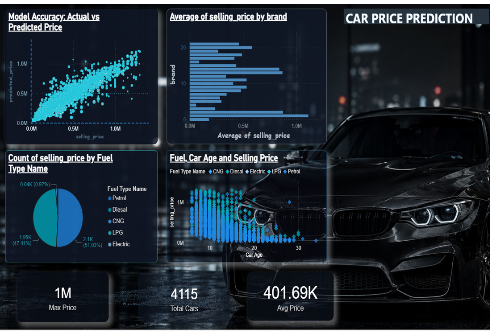

# 🚗 Car Selling Price Prediction

### 📊 Predict Car Prices. Discover Market Trends. Make Smarter Decisions.

An exploratory data analysis and machine learning project designed to predict the selling prices of used cars based on their characteristics. The project combines price prediction with interactive visual analytics to explore how factors such as brand, fuel type, and car age relate to selling prices.

---

## ✨ Project Highlights

- 🤖 **Price Prediction** — Compare actual and predicted selling prices.
- 🏷️ **Brand Analysis** — Explore average selling prices across car brands.
- ⛽ **Fuel Type Analysis** — Understand the distribution of cars by fuel type.
- 📅 **Car Age Analysis** — Investigate the relationship between vehicle age and selling price.
- 📈 **Interactive Dashboard** — Present insights through charts and key performance indicators.
- 💰 **Market Insights** — Examine average prices, maximum prices, and the number of cars analyzed.

---

## 📸 Dashboard Preview



*Dashboard showing prediction accuracy, brand-wise average prices, fuel-type distribution, car age analysis, and key metrics.*

> Keep `CarSellingPrice_Visualization.png` in the same directory as this README, or update the image path to match your project structure.

---

## 📊 Key Dashboard Metrics

| Metric | Value |
|---|---:|
| Total Cars Analyzed | 4,115 |
| Average Selling Price | 401.69K |
| Maximum Selling Price | 1M |

*These values are taken from the displayed dashboard. Currency and price units should be specified according to the original dataset.*

---

## 🔍 Exploratory Data Analysis

### 1. 🎯 Actual vs. Predicted Prices
Compare model predictions with actual selling prices to visualize how closely the predictions follow observed values.

### 2. 🏷️ Average Selling Price by Brand
Identify differences in average selling prices across car brands and explore brand-related pricing patterns.

### 3. ⛽ Fuel Type Distribution
Analyze the distribution of vehicles across fuel categories, including Petrol, Diesel, CNG, LPG, and Electric.

### 4. 📅 Fuel Type, Car Age, and Selling Price
Explore how vehicle age and fuel type relate to selling prices and identify potential depreciation patterns.

---

## 🛠️ Technology Stack

- **Python** — Data processing and machine learning
- **Pandas** — Data manipulation and analysis
- **NumPy** — Numerical computations
- **Scikit-learn** — Machine learning and model evaluation
- **Matplotlib / Seaborn** — Data visualization
- **Power BI** — Dashboard and interactive visual analytics, if used in the project

*Update this list to reflect the libraries and dashboard tools actually used in your implementation.*

---

## ⚙️ Getting Started

### 1. Clone the repository

```bash
git clone YOUR_GITHUB_REPOSITORY_URL
cd YOUR_PROJECT_FOLDER
```

Replace the placeholders with your actual GitHub repository URL and project folder name.

### 2. Create a virtual environment

```bash
python -m venv .venv
```

Activate it on Windows PowerShell:

```powershell
.venv\Scripts\Activate.ps1
```

### 3. Install dependencies

If your project contains a `requirements.txt` file:

```bash
pip install -r requirements.txt
```

Otherwise, install the dependencies required by your project.

### 4. Run the project

Run the appropriate Python script or open the dashboard using the tool used to build it.

For example:

```bash
python main.py
```

Replace `main.py` with the actual entry-point filename in your project.

---

## 📈 Model Evaluation

The actual-versus-predicted scatter plot provides a visual way to assess model performance.

For a more complete evaluation, consider reporting:

- **MAE:** Mean Absolute Error
- **RMSE:** Root Mean Squared Error
- **R² Score:** Proportion of price variation explained by the model

*Add the measured evaluation scores from your trained model rather than assuming a particular accuracy.*

---

## 💡 Potential Applications

- 🚘 Estimating used-car selling prices
- 💰 Supporting buyers and sellers during price negotiations
- 📊 Exploring automotive market trends
- 🔎 Understanding the influence of vehicle characteristics on pricing

These are potential applications; the predictions should not be treated as guaranteed market prices.

---

## 🚀 Future Improvements

- [ ] Add more vehicle features to improve predictions.
- [ ] Compare multiple machine learning algorithms.
- [ ] Display MAE, RMSE, and R² scores.
- [ ] Build an interactive interface for entering car details.
- [ ] Deploy the prediction model as a web application.
- [ ] Add model explainability to understand important price factors.

---

## 👩‍💻 Author

**Amitha**

GitHub: [@amitha052003](https://github.com/amitha052003)

---

## ⭐ Show Your Support

If you find this project interesting, consider giving the repository a ⭐ on GitHub!

<p align="center">
  <b>Built with ❤️, Python, Machine Learning, and Data Visualization</b>
</p>
